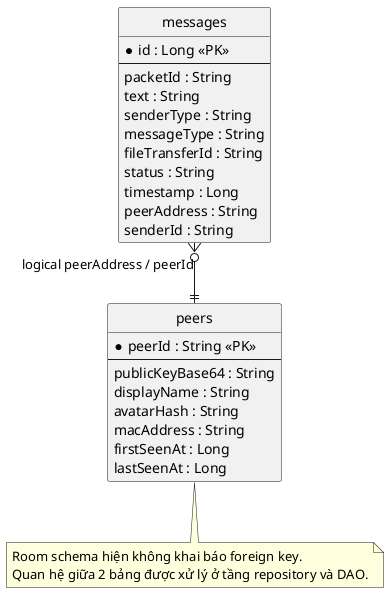

# Database Design

## 1. Tổng quan

Ứng dụng đang dùng Room với database tên `p2p_chat.db`, version `3`.
Schema hiện tại gồm 2 bảng chính:

| Table | Mục đích |
| --- | --- |
| `messages` | Lưu tin nhắn 1:1, nhóm, file message và trạng thái gửi/nhận. |
| `peers` | Lưu thông tin peer đã handshake/xác thực. |

## 2. Thiết kế bảng

### 2.1 `messages`

| Cột | Kiểu | Khóa | Null | Mô tả |
| --- | --- | --- | --- | --- |
| `id` | Long | PK, auto | No | Khóa chính tự tăng. |
| `packetId` | String | - | Yes | ID packet mạng tương ứng. |
| `text` | String | - | No | Nội dung text hoặc mô tả file. |
| `senderType` | String | - | No | SENT / RECEIVED. |
| `messageType` | String | - | No | TEXT / FILE / ... |
| `fileTransferId` | String | - | Yes | ID phiên truyền file. |
| `status` | String | - | No | NONE / SENDING / SENT / DELIVERED / READ / FAILED. |
| `timestamp` | Long | - | No | Thời gian tạo message. |
| `peerAddress` | String | - | No | Khóa logic để gom hội thoại theo peer/group. |
| `senderId` | String | - | Yes | Peer hash của người gửi. |

### 2.2 `peers`

| Cột | Kiểu | Khóa | Null | Mô tả |
| --- | --- | --- | --- | --- |
| `peerId` | String | PK | No | SHA-256 hash của public key, định danh peer. |
| `publicKeyBase64` | String | - | No | Public key ở dạng Base64. |
| `displayName` | String | - | No | Tên hiển thị của peer. |
| `avatarHash` | String | - | Yes | Hash avatar, nếu có. |
| `macAddress` | String | - | No | Địa chỉ MAC dùng cho Wi‑Fi Direct / debug. |
| `firstSeenAt` | Long | - | No | Lần đầu nhìn thấy peer. |
| `lastSeenAt` | Long | - | No | Lần cuối cập nhật peer. |

## 3. Quan hệ dữ liệu

- `messages.peerAddress` là khóa logic để truy vấn lịch sử hội thoại.
- `peers.peerId` là khóa chính của bảng peer và được dùng để nhận dạng peer đã xác thực.
- Hiện schema không khai báo foreign key vật lý giữa `messages` và `peers`; quan hệ là logic ở tầng repository.

## 4. Ràng buộc và hành vi

- `ChatMessageDao.insert()` dùng `OnConflictStrategy.REPLACE`.
- `PeerDao.insertPeer()` dùng `OnConflictStrategy.REPLACE`.
- `AppDatabase` đang dùng `fallbackToDestructiveMigration()`, nên khi thay đổi schema không có migration đầy đủ thì dữ liệu cũ có thể bị xóa.

## 5. PlantUML database diagram

## 6. Kết luận

Thiết kế CSDL tập trung vào 2 thực thể lõi: hội thoại và peer đã xác thực. Mô hình này phù hợp với kiến trúc P2P chat, trong đó dữ liệu cục bộ là nguồn hiển thị chính cho UI và trạng thái đồng bộ.