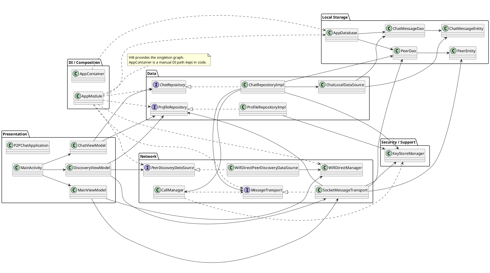

# Class Diagram Analysis

## 1. Phạm vi

Sơ đồ lớp dưới đây mô tả kiến trúc chính của P2P_Chat theo các tầng: Presentation, Data, Network, DI và Local Storage.

## 2. Các lớp chính

| Nhóm | Lớp |
| --- | --- |
| Presentation | `P2PChatApplication`, `MainActivity`, `MainViewModel`, `DiscoveryViewModel`, `ChatViewModel` |
| DI / Composition | `AppModule`, `AppContainer` |
| Data | `ChatRepository`, `ChatRepositoryImpl`, `ProfileRepository`, `ChatLocalDataSource` |
| Local storage | `AppDatabase`, `ChatMessageDao`, `PeerDao`, `ChatMessageEntity`, `PeerEntity` |
| Network | `MessageTransport`, `SocketMessageTransport`, `WifiDirectManager`, `WifiDirectPeerDiscoveryDataSource`, `CallManager` |
| Security / Support | `KeyStoreManager` |

## 3. Quan hệ chính

- `DiscoveryViewModel` điều phối quét peer, kết nối và điều hướng sang chat.
- `ChatViewModel` điều phối gửi tin nhắn, file, typing, call signaling và đọc dữ liệu hiển thị.
- `ChatRepositoryImpl` là trung tâm nghiệp vụ chat; nó ghi dữ liệu cục bộ qua `ChatLocalDataSource` và gửi packet qua `MessageTransport`.
- `SocketMessageTransport` quản lý socket control channel, handshake, ACK và trạng thái kết nối.
- `AppDatabase` chứa hai bảng Room chính: `messages` và `peers`.

## 4. PlantUML class diagram

## 5. Ghi chú

- `SocketMessageTransport` là lớp giữ vai trò quan trọng nhất ở tầng network vì nó xử lý handshake, trạng thái kết nối và giao tiếp packet.
- `ChatRepositoryImpl` vừa lưu cục bộ vừa phát packet, nên đây là điểm hội tụ giữa dữ liệu và mạng.
- `AppModule` là đường DI chính hiện tại; `AppContainer` vẫn tồn tại như cấu trúc khởi tạo thủ công.