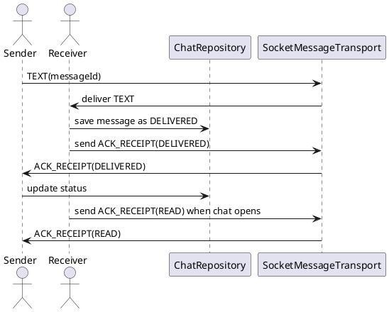

# ACK Receipt — Biên Nhận Tin Nhắn

## Tổng quan

Cập nhật trạng thái tin nhắn giữa hai peer sau khi tin nhắn được giao thành công (`DELIVERED`) và khi người dùng mở màn hình chat (`READ`).

---

## Packet mẫu

```json
{
  "type": "ACK_RECEIPT",
  "messageId": "uuid-1234",
  "status": "DELIVERED"
}
```

> `status` có thể là `"DELIVERED"` hoặc `"READ"`.

---

## Sơ đồ luồng

```
Receiver nhận TEXT
  → lưu message cục bộ (DELIVERED)
  → gửi ACK_RECEIPT(DELIVERED)
  → Sender cập nhật DB

Khi Receiver mở ChatScreen
  → gửi ACK_RECEIPT(READ)
  → Sender cập nhật DB
```

---

## Behavior

| Tình huống | Hành vi |
|---|---|
| Nhận được `TEXT` | Lưu message cục bộ với status `DELIVERED`, gửi `ACK_RECEIPT(DELIVERED)` ngay lập tức |
| Mở `ChatScreen` | Gửi `ACK_RECEIPT(READ)` cho tất cả tin nhắn chưa đọc từ peer đó |
| Nhận ACK từ chính mình | Bỏ qua — không xử lý |
| ACK đã được áp dụng trước đó | Bỏ qua — tránh vòng lặp vô hạn |

---

## Đặc tả Use Case

| Thuộc Tính | Mô tả |
|---|---|
| **Mã UC** | UC-ACK-01 |
| **Tên** | Biên nhận tin nhắn |
| **Actor** | Peer nhận, Peer gửi |
| **Mô tả** | Cập nhật trạng thái tin nhắn từ `DELIVERED` sang `READ` và phản hồi `ACK_RECEIPT` tương ứng. |
| **Tiền điều kiện** | Hai peer đã kết nối thành công và `messageId` tồn tại hợp lệ. |
| **Luồng chính** | Nhận `TEXT` → lưu cục bộ → gửi `ACK_RECEIPT(DELIVERED)` → người gửi cập nhật trạng thái → khi mở chat gửi `ACK_RECEIPT(READ)`. |
| **Luồng thay thế** | Bỏ qua ACK trùng lặp, ACK từ chính mình hoặc ACK đã được áp dụng trước đó. |
| **Hậu điều kiện** | Trạng thái tin nhắn được đồng bộ chính xác giữa hai peer. |

---

## Sequence Diagram



---

> **Lưu ý:** Bắt buộc kiểm tra `senderId != localPeerId` trước khi xử lý ACK để ngăn vòng lặp vô hạn.
