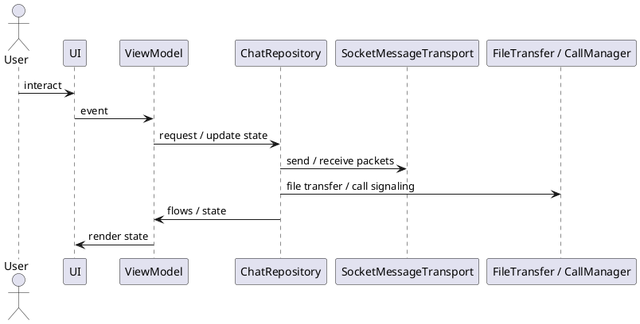

# Architecture — Kiến Trúc Ứng Dụng (MVVM + Flow)

## Tổng quan

Ứng dụng được xây dựng theo mô hình **MVVM + Flow**, tách biệt rõ ràng các lớp UI, logic nghiệp vụ và dữ liệu. Toàn bộ luồng dữ liệu đi qua một entry point duy nhất là `ChatRepository`.

---

## Các thành phần chính

| Lớp | Thành phần | Vai trò |
|---|---|---|
| **UI** | `DiscoveryScreen`, `ChatScreen` | Hiển thị dữ liệu, phát sự kiện người dùng |
| **ViewModel** | `DiscoveryViewModel`, `ChatViewModel` | Xử lý state, expose `StateFlow` / `SharedFlow` |
| **Repository** | `ChatRepositoryImpl` | Điều phối transport, DB, file transfer, call |
| **Transport** | `SocketMessageTransport` | Quản lý socket IO và handshake |
| **Persistence** | Room (`MessageEntity`, `PeerDao`) | Lưu trữ tin nhắn và thông tin peer |
| **DI** | Hilt (`AppModule`) | Cung cấp singleton cho toàn ứng dụng |

---

## Sơ đồ luồng tổng quan

```
UI
 ↕ collectAsStateWithLifecycle()
ViewModel
 ↕ StateFlow / SharedFlow
ChatRepository
 ├── SocketMessageTransport   (gửi / nhận packet)
 ├── FileTransfer             (truyền file)
 └── CallManager              (signaling cuộc gọi)
```

---

## Đặc tả Use Case

| Thuộc Tính | Mô tả |
|---|---|
| **Mã UC** | UC-ARC-01 |
| **Tên** | Điều phối kiến trúc ứng dụng |
| **Actor** | Người dùng ứng dụng, hệ thống |
| **Mô tả** | Điều phối UI, ViewModel, repository, transport và lớp lưu trữ theo luồng MVVM + Flow nhất quán. |
| **Tiền điều kiện** | Ứng dụng đã khởi tạo và Dependency Injection (Hilt) đã sẵn sàng. |
| **Luồng chính** | UI phát sự kiện → ViewModel xử lý state → Repository điều phối transport / persistence → UI render dữ liệu mới. |
| **Luồng thay thế** | Khi lỗi transport hoặc lưu trữ xảy ra, state lỗi được phát ngược về UI để xử lý và thông báo. |
| **Hậu điều kiện** | Các lớp được tách biệt hoàn toàn nhưng đồng bộ thông qua một luồng dữ liệu thống nhất. |

---

## Sequence Diagram



---

> **Lưu ý:** Sử dụng `collectAsStateWithLifecycle()` tại UI để thu thập flow an toàn theo vòng đời Activity/Fragment.
