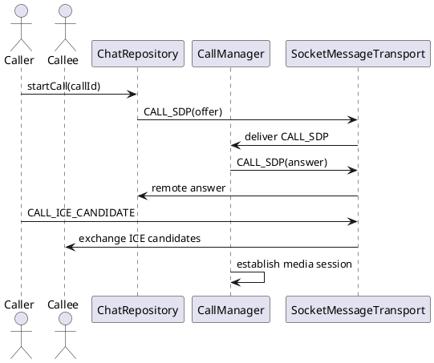

# Call Signaling — Báo Hiệu Cuộc Gọi (CallManager)

## Tổng quan

`CallManager` xử lý các packet báo hiệu cuộc gọi (SDP và ICE candidates) thông qua control channel. Thiết kế hướng tới tích hợp **WebRTC** trong tương lai để thiết lập phiên media P2P.

---

## Packet mẫu

### CALL_SDP

```json
{
  "type": "CALL_SDP",
  "callId": "call-1",
  "sdp": "v=0..."
}
```

### CALL_ICE_CANDIDATE

```json
{
  "type": "CALL_ICE_CANDIDATE",
  "callId": "call-1",
  "candidate": "candidate:..."
}
```

---

## Sơ đồ luồng

```
User bắt đầu cuộc gọi
  → ChatRepository gửi CALL_SDP (offer) đến peer
  → Peer CallManager nhận và xử lý SDP
  → Trao đổi ICE candidates (hai chiều)
  → Thiết lập phiên media P2P (WebRTC)
```

---

## Đặc tả Use Case

| Thuộc Tính | Mô tả |
|---|---|
| **Mã UC** | UC-CALL-01 |
| **Tên** | Báo hiệu cuộc gọi |
| **Actor** | Người gọi (Caller), người nhận (Callee) |
| **Mô tả** | Trao đổi SDP và ICE candidates qua control channel để thiết lập phiên gọi P2P. |
| **Tiền điều kiện** | Hai peer đã kết nối và xác thực thành công (`CONNECTED_AND_VERIFIED`). |
| **Luồng chính** | Người gọi gửi `CALL_SDP` (offer) → người nhận xử lý SDP và phản hồi answer → trao đổi ICE candidates → thiết lập media session. |
| **Luồng thay thế** | SDP hoặc ICE không hợp lệ → kết thúc thiết lập cuộc gọi và báo lỗi cho cả hai phía. |
| **Hậu điều kiện** | Phiên gọi được thiết lập thành công hoặc bị hủy an toàn với thông báo lỗi rõ ràng. |

---

## Sequence Diagram



---

> **Lưu ý — Tích hợp WebRTC:** Để triển khai cuộc gọi thực tế, thêm dependency WebRTC, khởi tạo `PeerConnection` và media streams, rồi sử dụng các packet `CALL_SDP` / `CALL_ICE_CANDIDATE` hiện có để trao đổi thông tin thiết lập kết nối.
