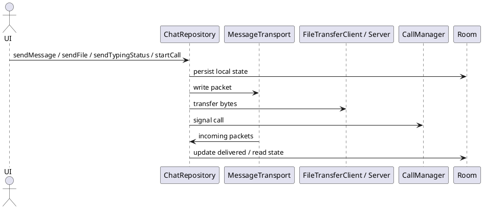

# ChatRepository — Điều Phối Dữ Liệu Chat

## Tổng quan

`ChatRepository` là **single entry point** cho toàn bộ nghiệp vụ: nhắn tin, typing indicator, truyền file và báo hiệu cuộc gọi. Mọi tương tác từ ViewModel đều đi qua lớp này trước khi xuống transport và persistence.

---

## Public API

| Phương thức | Mô tả |
|---|---|
| `sendMessage(peerAddress, text)` | Gửi tin nhắn văn bản 1:1 |
| `sendGroupMessage(groupId, text)` | Gửi tin nhắn nhóm |
| `sendFile(peerAddress, uri)` | Khởi tạo truyền file |
| `observeFileProgress(fileTransferId): Flow<Float>` | Theo dõi tiến trình truyền file |
| `sendTypingStatus(peerAddress, isTyping)` | Gửi trạng thái đang nhập |
| `observeTypingStatus(peerAddress): Flow<Boolean>` | Quan sát trạng thái nhập của peer |
| `startCall(targetPeerId, callId)` | Bắt đầu cuộc gọi |
| `stopCall(callId)` | Kết thúc cuộc gọi |

---

## Luồng nội bộ — Gửi file

```
sendFile(peerAddress, uri)
  → tạo fileTransferId (UUID)
  → pendingFileTransfers[fileTransferId] = uri
  → gửi FILE_HEADER qua control channel (8988)
  → khi remote sẵn sàng: FileTransferClient kết nối (8989)
  → stream chunks → cập nhật _fileProgressMap
  → observeFileProgress() phát tiến trình ra UI
```

---

## Đặc tả Use Case

| Thuộc Tính | Mô tả |
|---|---|
| **Mã UC** | UC-REPO-01 |
| **Tên** | Điều phối dữ liệu chat |
| **Actor** | Lớp UI, transport, file service, call manager |
| **Mô tả** | Là đầu mối duy nhất cho gửi tin nhắn, file, typing status và signaling cuộc gọi; đồng bộ trạng thái qua các flow. |
| **Tiền điều kiện** | Repository đã được khởi tạo (Hilt inject) và các dependency transport / persistence sẵn sàng. |
| **Luồng chính** | UI gọi API → repository lưu trạng thái cục bộ → điều phối transport / dịch vụ → phát flow trạng thái ra ViewModel / UI. |
| **Luồng thay thế** | Khi transport thất bại, repository giữ dữ liệu cục bộ, báo lỗi qua flow để UI xử lý retry. |
| **Hậu điều kiện** | Dữ liệu chat, tiến trình file và trạng thái typing được đồng bộ nhất quán giữa các lớp. |

---

## Sequence Diagram



---

> **Lưu ý:** Typing status được phát qua `MutableSharedFlow` — cấu hình buffer phù hợp để xử lý burst không bị mất sự kiện.
