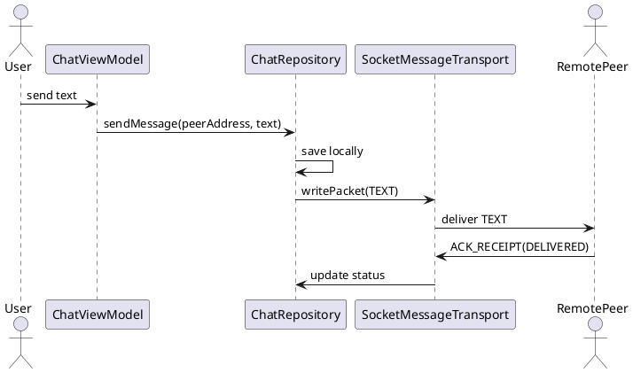

# Chat 1:1 — Gửi / Nhận Tin Nhắn

## Tổng quan

Cho phép hai peer trao đổi tin nhắn văn bản qua control channel. Tin nhắn được lưu cục bộ trước khi gửi để đảm bảo tính bền vững và hiển thị trạng thái chính xác ngay cả khi mất kết nối.

---

## Cổng kết nối

| Kênh | Cổng | Giao thức |
|---|---|---|
| Control channel | `8988` | TCP socket |

---

## Packet mẫu

### TEXT (gửi đi)

```json
{
  "type": "TEXT",
  "messageId": "uuid-1234",
  "senderId": "peerHashA",
  "text": "Xin chào",
  "timestamp": 1670000000000
}
```

### ACK_RECEIPT (phản hồi khi nhận)

```json
{
  "type": "ACK_RECEIPT",
  "messageId": "uuid-1234",
  "status": "DELIVERED"
}
```

---

## Sơ đồ luồng

```
UI → ChatViewModel → ChatRepository.sendMessage()
  → lưu message cục bộ
  → SocketMessageTransport.writePacket(TEXT)
  → RemotePeer nhận TEXT
  → lưu cục bộ
  → gửi ACK_RECEIPT(DELIVERED)
  → Sender cập nhật status → DELIVERED
```

---

## Đặc tả Use Case

| Thuộc Tính | Mô tả |
|---|---|
| **Mã UC** | UC-CHAT-01 |
| **Tên** | Chat 1:1 |
| **Actor** | Người dùng (Sender), Peer từ xa (Receiver) |
| **Mô tả** | Gửi và nhận tin nhắn văn bản giữa hai peer qua control channel, có xác nhận biên nhận. |
| **Tiền điều kiện** | Hai peer đã kết nối (`CONNECTED_AND_VERIFIED`) và có thể trao đổi packet `TEXT`. |
| **Luồng chính** | Người dùng gửi tin nhắn → lưu cục bộ → gửi `TEXT` → peer nhận lưu lại → trả `ACK_RECEIPT(DELIVERED)` → cập nhật trạng thái. |
| **Luồng thay thế** | Nếu lỗi truyền, tin nhắn vẫn được giữ cục bộ để retry khi kết nối được khôi phục. |
| **Hậu điều kiện** | Tin nhắn tồn tại ở cả hai phía và trạng thái được đồng bộ chính xác. |

---

## Sequence Diagram



---

> **Lưu ý:** Tin nhắn được lưu cục bộ trước khi gửi để hỗ trợ chế độ offline và đảm bảo trạng thái hiển thị nhất quán trên UI.
