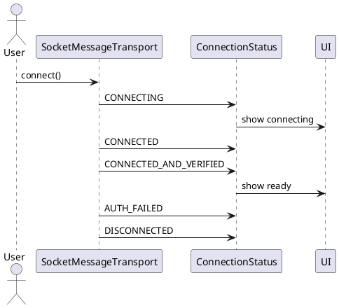

# Connection Status — Trạng Thái Kết Nối

## Tổng quan

`ConnectionStatus` là enum mô tả toàn bộ vòng đời kết nối socket. `SocketMessageTransport` emit các giá trị này để UI và repository phản ứng kịp thời với từng thay đổi trạng thái.

---

## Các trạng thái

| Trạng thái | Ý nghĩa |
|---|---|
| `DISCONNECTED` | Socket đã đóng hoặc chưa được kết nối |
| `CONNECTING` | Đang trong quá trình thiết lập kết nối |
| `CONNECTED` | Kết nối socket thành công, chưa xác thực |
| `CONNECTED_AND_VERIFIED` | Handshake hoàn tất, phiên đã được xác thực |
| `AUTH_FAILED` | Xác thực thất bại — kết nối bị từ chối |

---

## Sơ đồ luồng

```
connect()
  → emit CONNECTING
  → thực hiện handshake
  → thành công  → emit CONNECTED_AND_VERIFIED
  → thất bại    → emit AUTH_FAILED
  → socket đóng → emit DISCONNECTED
```

---

## Đặc tả Use Case

| Thuộc Tính | Mô tả |
|---|---|
| **Mã UC** | UC-CONN-01 |
| **Tên** | Quản lý trạng thái kết nối |
| **Actor** | Socket transport, UI |
| **Mô tả** | Phát và tiêu thụ trạng thái kết nối trong suốt vòng đời socket để UI và repository phản ứng chính xác. |
| **Tiền điều kiện** | Đang thực hiện kết nối hoặc socket đang hoạt động. |
| **Luồng chính** | Emit `CONNECTING` → tiến hành handshake → emit `CONNECTED_AND_VERIFIED` → khi đóng socket emit `DISCONNECTED`. |
| **Luồng thay thế** | Xác thực thất bại → emit `AUTH_FAILED` thay vì `CONNECTED_AND_VERIFIED`. |
| **Hậu điều kiện** | UI và repository nhận được trạng thái kết nối chính xác và kịp thời để xử lý hiển thị hoặc retry. |

---

## Sequence Diagram



---

> **Lưu ý:** `CONNECTED_AND_VERIFIED` chỉ được emit sau khi quá trình handshake và xác minh cryptographic hoàn tất thành công.
