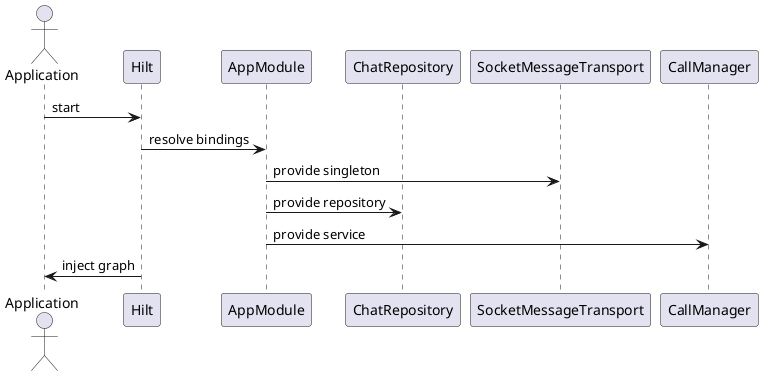

# Dependency Injection — Tiêm Phụ Thuộc (Hilt)

## Tổng quan

Hilt được dùng để quản lý vòng đời các dependency cốt lõi của ứng dụng. Tất cả singleton được khai báo trong `di/AppModule.kt` với scope `@Singleton` (ApplicationScope).

---

## Các binding chính

| Dependency | Scope | Mô tả |
|---|---|---|
| `SocketMessageTransport` | `@Singleton` | Transport socket duy nhất cho toàn app |
| `ChatRepositoryImpl` | `@Singleton` | Entry point điều phối chat |
| `KeyStoreManager` | `@Singleton` | Quản lý khóa mã hóa và peerId |
| `CallManager` | `@Singleton` | Xử lý signaling cuộc gọi |
| `ApplicationScope` | `@Singleton` | CoroutineScope dài hạn inject vào transport |

---

## Ví dụ binding

```kotlin
@Module
@InstallIn(SingletonComponent::class)
object AppModule {

    @Provides
    @Singleton
    fun provideSocketTransport(
        keyStoreManager: KeyStoreManager,
        scope: CoroutineScope
    ): MessageTransport = SocketMessageTransport(keyStoreManager, scope)

    @Provides
    @Singleton
    fun provideChatRepository(
        transport: MessageTransport,
        db: AppDatabase,
        callManager: CallManager
    ): ChatRepository = ChatRepositoryImpl(transport, db, callManager)
}
```

---

## Đặc tả Use Case

| Thuộc Tính | Mô tả |
|---|---|
| **Mã UC** | UC-DI-01 |
| **Tên** | Tiêm phụ thuộc ứng dụng |
| **Actor** | Hệ thống khởi động ứng dụng |
| **Mô tả** | Cấu hình và cung cấp các singleton / scoped object thông qua Hilt để đảm bảo tái sử dụng và quản lý vòng đời đúng đắn. |
| **Tiền điều kiện** | Hilt được khai báo đúng trong `Application` class và `AppModule` đã được định nghĩa. |
| **Luồng chính** | Hilt resolve bindings → cung cấp repository / transport / service → inject vào các lớp sử dụng (ViewModel, Repository...). |
| **Luồng thay thế** | Thiếu binding → dependency graph khởi tạo thất bại ngay khi app start (fail-fast). |
| **Hậu điều kiện** | Các dependency dùng chung được khởi tạo đúng một lần và sẵn sàng cho toàn bộ ứng dụng. |

---

## Sequence Diagram



---

> **Lưu ý:** Khi thêm hoặc sửa dependency, cần cập nhật `di/AppModule.kt`. `ApplicationScope` phải được inject vào các transport để quản lý coroutine dài hạn đúng cách.
