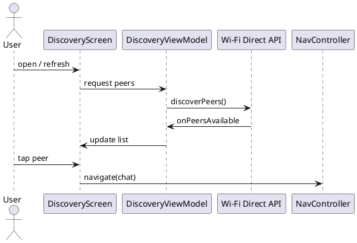

# Discovery — Khám Phá Peer

## Tổng quan

Phát hiện các thiết bị lân cận thông qua **Wi-Fi Direct API** của Android và hiển thị danh sách trong `DiscoveryScreen`. Người dùng chọn peer để chuyển sang màn hình chat.

---

## Cơ chế hoạt động

| Thành phần | Vai trò |
|---|---|
| `DiscoveryManager` | Gọi `discoverPeers()` qua Wi-Fi Direct API |
| `DiscoveryViewModel` | Nhận callback `onPeersAvailable`, expose danh sách peer |
| `DiscoveryScreen` | Render danh sách, xử lý tap để điều hướng |
| `NavController` | Điều hướng sang `ChatScreen` với `peerAddress` |

> Không sử dụng HTTP hay packet mạng chuyên biệt — thông tin peer lấy trực tiếp từ `WifiP2pDevice`.

---

## Payload peer mẫu (từ WifiP2pDevice)

```json
{
  "deviceName": "Peer-Device",
  "deviceAddress": "02:11:22:33:44:55",
  "isGroupOwner": false
}
```

---

## Sơ đồ luồng

```
User mở DiscoveryScreen
  → DiscoveryViewModel.discoverPeers()
  → Wi-Fi Direct API quét thiết bị lân cận
  → onPeersAvailable(peers)
  → ViewModel cập nhật danh sách
  → UI hiển thị peer list
  → User chọn peer
  → NavController.navigate("/chat?peerAddress=...")
```

---

## Đặc tả Use Case

| Thuộc Tính | Mô tả |
|---|---|
| **Mã UC** | UC-DISC-01 |
| **Tên** | Khám phá peer |
| **Actor** | Người dùng, hệ thống Wi-Fi Direct |
| **Mô tả** | Tìm kiếm và hiển thị các peer khả dụng trong vùng lân cận để người dùng lựa chọn kết nối. |
| **Tiền điều kiện** | Wi-Fi Direct được bật trên thiết bị và quyền `ACCESS_FINE_LOCATION` / `NEARBY_WIFI_DEVICES` đã được cấp. |
| **Luồng chính** | Người dùng mở màn hình → hệ thống quét peer → ViewModel cập nhật danh sách → UI hiển thị → người dùng chọn peer để vào chat. |
| **Luồng thay thế** | Không tìm thấy peer → danh sách rỗng, UI hiển thị trạng thái phù hợp (empty state). |
| **Hậu điều kiện** | Peer được chọn và `peerAddress` sẵn sàng để truyền sang màn hình chat qua NavController. |

---

## Sequence Diagram



---

> **Lưu ý:** Khi điều hướng sang chat, luôn encode `peerAddress` bằng `Uri.encode()` để tránh lỗi với các ký tự đặc biệt trong địa chỉ MAC.
