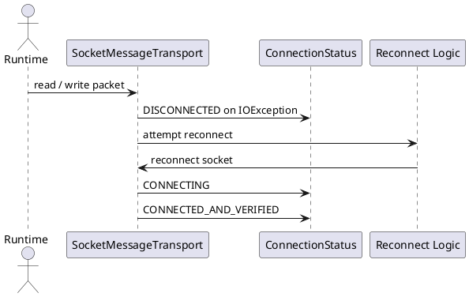

# Error Handling & Reconnect — Xử Lý Lỗi và Tự Kết Nối Lại

## Tổng quan

Mọi thao tác socket I/O đều được bọc trong `try/catch`. Khi phát hiện lỗi, hệ thống emit trạng thái phù hợp và cố gắng khôi phục kết nối nếu `ForegroundService` còn đang chạy.

---

## Các cơ chế bảo vệ

| Cơ chế | Mô tả |
|---|---|
| **IOException guard** | `socket.read()` / `write()` bọc trong `try/catch(IOException)` — emit `DISCONNECTED` khi gặp lỗi |
| **Reconnect logic** | Nếu service nền còn sống, tự động thử kết nối lại và thực hiện lại handshake |
| **ACK loop guard** | Khi nhận `ACK_RECEIPT`, kiểm tra `packet.senderId != localPeerId` và status chưa được áp dụng |
| **Duplicate packet guard** | Bỏ qua packet trùng lặp thay vì tái xử lý |

---

## Sơ đồ luồng

```
socket.read() / write() ném IOException
  → emit DISCONNECTED
  → kiểm tra ForegroundService còn sống?
      Có → attempt reconnect
            → emit CONNECTING
            → thực hiện lại handshake
            → emit CONNECTED_AND_VERIFIED
      Không → giữ trạng thái DISCONNECTED, báo UI
```

---

## Đặc tả Use Case

| Thuộc Tính | Mô tả |
|---|---|
| **Mã UC** | UC-ERR-01 |
| **Tên** | Xử lý lỗi và tự kết nối lại |
| **Actor** | Runtime socket, service nền (ForegroundService) |
| **Mô tả** | Bắt lỗi IO trên socket, phát trạng thái phù hợp và tự động thử khôi phục kết nối khi điều kiện cho phép. |
| **Tiền điều kiện** | Socket đang hoạt động hoặc đang được khởi tạo lại sau lỗi trước đó. |
| **Luồng chính** | Phát hiện `IOException` → emit `DISCONNECTED` → thử reconnect → thực hiện handshake lại → trở về `CONNECTED_AND_VERIFIED`. |
| **Luồng thay thế** | Không thể reconnect (service đã dừng) → trạng thái lỗi được giữ nguyên để UI thông báo người dùng. |
| **Hậu điều kiện** | Kết nối được khôi phục thành công hoặc lỗi được báo rõ ràng qua connection status flow. |

---

## Sequence Diagram



---

> **Lưu ý:** Unit test cần bao phủ hai trường hợp: (1) ACK loop guard từ chối ACK của chính mình, (2) chuỗi reconnect thành công sau IOException.
