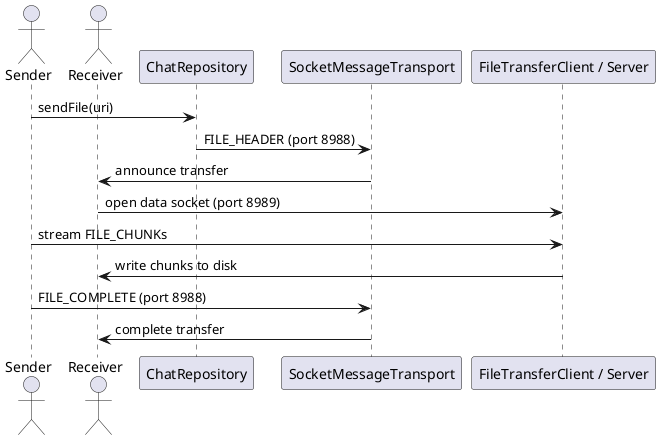

# File Transfer — Truyền File

## Tổng quan

Truyền file sử dụng hai kênh riêng biệt: **control channel** (port `8988`) để báo hiệu và **data channel** (port `8989`) để stream dữ liệu thực tế. Tách kênh này tránh làm nghẽn control channel trong khi truyền file lớn.

---

## Cổng kết nối

| Kênh | Cổng | Mục đích |
|---|---|---|
| Control | `8988` | Gửi `FILE_HEADER`, `FILE_COMPLETE` |
| Data | `8989` | Stream `FILE_CHUNK` (bytes thực tế) |

---

## Packet mẫu

### FILE_HEADER (control channel)

```json
{
  "type": "FILE_HEADER",
  "fileTransferId": "uuid-ft-1",
  "fileName": "photo.jpg",
  "mimeType": "image/jpeg",
  "totalSize": 1234567,
  "totalChunks": 12
}
```

### FILE_CHUNK (data channel — port 8989)

```json
{
  "fileTransferId": "uuid-ft-1",
  "chunkIndex": 0,
  "data": "BASE64_CHUNK"
}
```

### FILE_COMPLETE (control channel)

```json
{
  "type": "FILE_COMPLETE",
  "fileTransferId": "uuid-ft-1"
}
```

---

## Sơ đồ luồng

```
Sender.sendFile(uri)
  → gửi FILE_HEADER qua control (8988)
  → Receiver mở FileTransferServer (8989)
  → Receiver gửi tín hiệu READY
  → Sender kết nối đến 8989
  → stream FILE_CHUNK[]
  → Receiver ghi file từng chunk
  → Sender gửi FILE_COMPLETE qua control (8988)
  → Transfer kết thúc — progress = 100%
```

---

## Theo dõi tiến trình

```kotlin
// Quan sát tiến trình theo fileTransferId
chatRepository.observeFileProgress(fileTransferId): Flow<Float>
// Phát giá trị từ 0.0f đến 1.0f
```

---

## Đặc tả Use Case

| Thuộc Tính | Mô tả |
|---|---|
| **Mã UC** | UC-FILE-01 |
| **Tên** | Truyền file |
| **Actor** | Người gửi (Sender), người nhận (Receiver) |
| **Mô tả** | Gửi file qua kênh dữ liệu riêng biệt (port 8989) để không làm nghẽn control channel (port 8988). |
| **Tiền điều kiện** | Peer đã kết nối (`CONNECTED_AND_VERIFIED`) và URI file có thể truy cập được. |
| **Luồng chính** | Gửi `FILE_HEADER` → mở data socket (8989) → stream `FILE_CHUNK[]` → Receiver ghi file → gửi `FILE_COMPLETE`. |
| **Luồng thay thế** | Lỗi trên data socket (8989) → transfer dừng ở trạng thái dang dở, có thể retry lại từ đầu. |
| **Hậu điều kiện** | File được lưu thành công ở phía nhận và `observeFileProgress` phát giá trị `1.0f`, hoặc trạng thái thất bại được báo rõ. |

---

## Sequence Diagram



---

> **Lưu ý:** Sử dụng socket riêng cho data channel để tránh block control channel. Tiến trình được cập nhật qua `SharedFlow` và quan sát từ UI thông qua `observeFileProgress()`.
