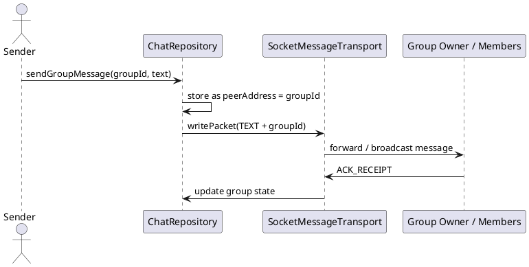

# Group Chat — Nhắn Tin Nhóm

## Tổng quan

Tin nhắn nhóm sử dụng `groupId` làm `peerAddress` để lưu trữ và định tuyến, tận dụng cùng infrastructure với chat 1:1. Packet `TEXT` được bổ sung thêm trường `groupId` để phân biệt và broadcast đến các thành viên.

---

## Cổng kết nối

| Kênh | Cổng | Mô tả |
|---|---|---|
| Control | `8988` | Gửi và nhận packet TEXT nhóm |

---

## Packet mẫu

### TEXT (group)

```json
{
  "type": "TEXT",
  "messageId": "uuid-gg-1",
  "senderId": "peerHashA",
  "groupId": "group-123",
  "text": "Hello group",
  "timestamp": 1670000000000
}
```

---

## Sơ đồ luồng

```
Sender.sendGroupMessage(groupId, text)
  → Repository lưu với peerAddress = groupId
  → Transport gửi packet TEXT + groupId
  → Group owner / relay forward đến từng thành viên
  → Mỗi thành viên nhận TEXT
  → Mỗi thành viên gửi ACK_RECEIPT về sender (hoặc group owner)
```

---

## Cơ chế lưu trữ

| Trường | Giá trị |
|---|---|
| `peerAddress` (DB) | `groupId` — UI subscribe theo kênh này |
| `senderId` | Định danh người gửi thực sự |
| `groupId` | Định danh nhóm trong packet |

---

## Đặc tả Use Case

| Thuộc Tính | Mô tả |
|---|---|
| **Mã UC** | UC-GROUP-01 |
| **Tên** | Chat nhóm |
| **Actor** | Thành viên nhóm |
| **Mô tả** | Gửi và nhận tin nhắn trong nhóm sử dụng `groupId` làm định danh kênh, tái dùng infrastructure chat 1:1. |
| **Tiền điều kiện** | Nhóm đã tồn tại, `groupId` đã được biết và các thành viên có thể truy cập kênh nhóm. |
| **Luồng chính** | Thành viên gửi message cho `groupId` → repository lưu cục bộ → transport forward packet → các thành viên nhận và gửi `ACK_RECEIPT`. |
| **Luồng thay thế** | Thành viên offline → bản ghi tin nhắn vẫn được giữ cục bộ để đồng bộ lại sau khi online. |
| **Hậu điều kiện** | Tin nhắn nhóm hiển thị trong conversation view của mọi thành viên hợp lệ. |

---

## Sequence Diagram



---

> **Lưu ý:** Tin nhắn nhóm được lưu với `peerAddress = groupId` để UI có thể subscribe đúng kênh hiển thị mà không cần thay đổi logic quan sát.
