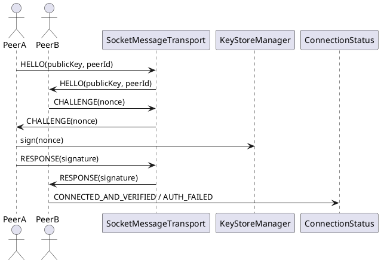

# Handshake & Authentication — Bắt Tay và Xác Thực

## Tổng quan

Quá trình xác thực diễn ra qua **3 pha**: trao đổi public key, phát challenge, và xác minh chữ ký. `KeyStoreManager` chịu trách nhiệm quản lý khóa và tạo `peerId` hash. Kết quả cuối cùng là emit `CONNECTED_AND_VERIFIED` hoặc `AUTH_FAILED`.

---

## Kênh kết nối

| Kênh | Cổng | Giao thức |
|---|---|---|
| Control channel | `8988` | TCP socket |

---

## Các packet trong handshake

### 1. HELLO

```json
{
  "type": "HELLO",
  "publicKey": "BASE64_PUBKEY",
  "peerId": "peerHashCandidate"
}
```

### 2. CHALLENGE

```json
{
  "type": "CHALLENGE",
  "nonce": "random-hex"
}
```

### 3. RESPONSE

```json
{
  "type": "RESPONSE",
  "nonce": "signed-by-private-key (BASE64)"
}
```

### 4. VERIFY_OK / VERIFY_FAIL

```json
{ "type": "VERIFY_OK" }
```

```json
{ "type": "VERIFY_FAIL" }
```

---

## Sơ đồ luồng

```
PeerA gửi HELLO (publicKey, peerId)
  → PeerB validate publicKey
  → PeerB gửi CHALLENGE (nonce)
  → PeerA ký nonce bằng private key
  → PeerA gửi RESPONSE (signature)
  → PeerB xác minh chữ ký
      Hợp lệ   → emit CONNECTED_AND_VERIFIED
      Không hợp lệ → emit AUTH_FAILED
```

---

## Đặc tả Use Case

| Thuộc Tính | Mô tả |
|---|---|
| **Mã UC** | UC-HAND-01 |
| **Tên** | Bắt tay và xác thực |
| **Actor** | Peer A, Peer B |
| **Mô tả** | Trao đổi public key, phát challenge và xác minh response để hai peer nhận diện và tin tưởng lẫn nhau trước khi bắt đầu nhắn tin. |
| **Tiền điều kiện** | Socket đã kết nối thành công và cả hai phía có thể trao đổi dữ liệu. |
| **Luồng chính** | Gửi `HELLO` → nhận `CHALLENGE` → ký nonce → gửi `RESPONSE` → xác minh chữ ký → emit `CONNECTED_AND_VERIFIED`. |
| **Luồng thay thế** | Chữ ký sai hoặc thiếu khóa → emit `AUTH_FAILED`, đóng kết nối an toàn. |
| **Hậu điều kiện** | Phiên kết nối được xác thực đầy đủ, hai peer có thể bắt đầu trao đổi tin nhắn an toàn. |

---

## Sequence Diagram



---

> **Lưu ý:** `KeyStoreManager` cung cấp `peerId` dưới dạng hash của public key và quản lý toàn bộ vòng đời khóa mã hóa. Không bao giờ truyền private key qua mạng.
