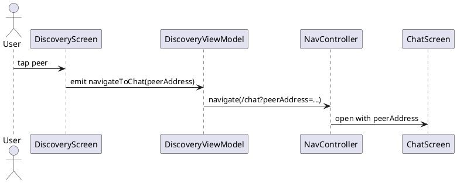

# Navigation — Điều Hướng Màn Hình

## Tổng quan

Ứng dụng sử dụng **Navigation Compose** để điều hướng giữa các màn hình. Luồng chính là `DiscoveryScreen → ChatScreen`, trong đó `peerAddress` được encode và truyền qua route argument.

---

## Các route

| Route | Màn hình | Tham số |
|---|---|---|
| `/discovery` | `DiscoveryScreen` | — |
| `/chat?peerAddress={peerAddress}` | `ChatScreen` | `peerAddress` (URL-encoded) |

---

## Ví dụ điều hướng

```kotlin
// Điều hướng sang ChatScreen — luôn encode peerAddress
navController.navigate("/chat?peerAddress=${Uri.encode(peerAddress)}")
```

---

## Payload truyền giữa màn hình

```json
{
  "peerAddress": "192.168.49.1",
  "displayName": "Alice"
}
```

---

## Sơ đồ luồng

```
User tap peer trên DiscoveryScreen
  → DiscoveryViewModel emit navigateToChat(peerAddress)
  → NavController.navigate("/chat?peerAddress=...")
  → NavHost render ChatScreen
  → ChatScreen nhận peerAddress từ route arguments
```

---

## Đặc tả Use Case

| Thuộc Tính | Mô tả |
|---|---|
| **Mã UC** | UC-NAV-01 |
| **Tên** | Điều hướng sang chat |
| **Actor** | Người dùng |
| **Mô tả** | Chuyển từ màn hình danh sách peer (`DiscoveryScreen`) sang màn hình chat (`ChatScreen`) với peer đã chọn, truyền `peerAddress` qua route argument. |
| **Tiền điều kiện** | `peerAddress` hợp lệ đã được lấy từ `DiscoveryScreen`. |
| **Luồng chính** | Người dùng chọn peer → ViewModel phát navigation event → `NavController` điều hướng đến `ChatScreen` → màn hình nhận đúng `peerAddress`. |
| **Luồng thay thế** | `peerAddress` không hợp lệ hoặc chứa ký tự đặc biệt → encode trước khi navigate để tránh lỗi route parsing. |
| **Hậu điều kiện** | `ChatScreen` mở thành công với đúng peer được chọn và sẵn sàng hiển thị lịch sử chat. |

---

## Sequence Diagram



---

> **Lưu ý:** Luôn dùng `Uri.encode(peerAddress)` trước khi đưa vào route để tránh lỗi với địa chỉ MAC hoặc IP có chứa ký tự đặc biệt (`:`, `.`).
