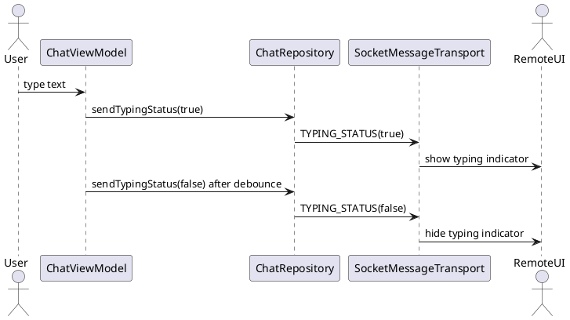

# Typing Indicator — Trạng Thái Đang Nhập (TYPING_STATUS)

## Tổng quan

Gửi trạng thái đang nhập đến peer từ xa để UI phía nhận hiển thị typing indicator. Sử dụng **debounce 3 giây** để tránh gửi quá nhiều packet lên control channel khi người dùng nhập liên tục.

---

## Packet mẫu

```json
{
  "type": "TYPING_STATUS",
  "isTyping": true
}
```

> `isTyping: false` được gửi sau 3 giây không có hoạt động nhập.

---

## API

| Phương thức | Mô tả |
|---|---|
| `ChatRepository.sendTypingStatus(peerAddress, isTyping)` | Gửi trạng thái nhập tới peer |
| `ChatRepository.observeTypingStatus(peerAddress): Flow<Boolean>` | Quan sát trạng thái nhập của peer từ xa |

---

## Sơ đồ luồng

```
User bắt đầu nhập
  → ChatViewModel debounce
  → sendTypingStatus(true)
  → Transport gửi TYPING_STATUS(true)
  → Remote UI hiển thị "đang nhập..."

User dừng nhập (3 giây không có input)
  → ChatViewModel debounce timeout
  → sendTypingStatus(false)
  → Transport gửi TYPING_STATUS(false)
  → Remote UI ẩn typing indicator
```

---

## Đặc tả Use Case

| Thuộc Tính | Mô tả |
|---|---|
| **Mã UC** | UC-TYPE-01 |
| **Tên** | Hiển thị trạng thái đang nhập |
| **Actor** | Người dùng chat, peer từ xa |
| **Mô tả** | Báo trạng thái đang nhập theo thời gian thực để UI phía nhận hiển thị typing indicator chính xác. |
| **Tiền điều kiện** | Cuộc chat đang mở và có kết nối `CONNECTED_AND_VERIFIED` với peer. |
| **Luồng chính** | Người dùng nhập → ViewModel debounce → gửi `TYPING_STATUS(true)` → phía nhận hiển thị indicator → hết nhập (3s) → gửi `TYPING_STATUS(false)` → ẩn indicator. |
| **Luồng thay thế** | Thay đổi trạng thái quá nhanh được gộp lại bởi debounce, tránh flood control channel. |
| **Hậu điều kiện** | Typing indicator phía nhận phản ánh đúng hoạt động nhập thực tế của người dùng. |

---

## Sequence Diagram



---

> **Lưu ý:** Debounce nên được áp dụng tại `ChatViewModel` — không gửi packet cho mỗi lần gõ phím. Thời gian debounce khuyến nghị là **3 giây** sau lần nhập cuối cùng.
