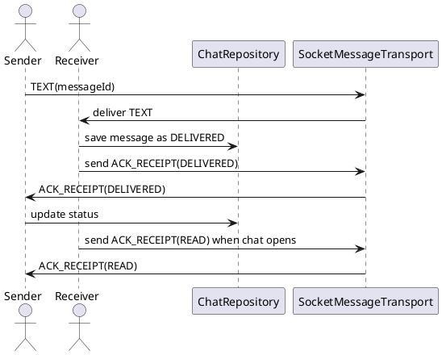

ACK Receipt (Biên nhận tin nhắn)

Mô tả:
- Biên nhận cập nhật trạng thái tin nhắn (DELIVERED, READ).

Packet mẫu:
{
  "type": "ACK_RECEIPT",
  "messageId": "uuid-1234",
  "status": "DELIVERED" // or "READ"
}

Behavior:
- On receiving TEXT: receiver saves message locally with status DELIVERED and immediately sends ACK_RECEIPT with status=DELIVERED.
- When ChatScreen becomes visible, send ACK_RECEIPT with status=READ for unread messages from that peer.
- Guard: do not respond to ACK loops (ignore ACKs from self or if already applied).

Sơ đồ luồng:
Receiver on TEXT -> save message -> send ACK_RECEIPT(DELIVERED) -> Sender updates DB status -> when user opens chat send ACK_RECEIPT(READ)

Ghi chú:
- Important to prevent infinite ACK loops by verifying senderId != localPeerId.

Bảng đặc tả use case:
| Thuộc Tính | Mô tả |
| --- | --- |
| Mã UC | UC-ACK-01 |
| Tên | Biên nhận tin nhắn |
| Actor | Peer nhận, Peer gửi |
| Mô tả | Cập nhật trạng thái tin nhắn từ DELIVERED sang READ và phản hồi ACK_RECEIPT. |
| Tiền điều kiện | Hai peer đã kết nối và có messageId hợp lệ. |
| Luồng chính | Nhận TEXT -> lưu cục bộ -> gửi ACK_RECEIPT(DELIVERED) -> người gửi cập nhật trạng thái -> khi mở chat gửi ACK_RECEIPT(READ). |
| Luồng thay thế | Bỏ qua ACK trùng lặp, ACK từ chính mình hoặc ACK đã được áp dụng trước đó. |
| Hậu điều kiện | Trạng thái tin nhắn được đồng bộ giữa hai bên. |

Use case specification:
- Primary actor: Peer receiver / sender.
- Preconditions: A message exists locally and the peer is reachable.
- Trigger: A TEXT message is received or the chat screen is opened.
- Main flow: Save message as DELIVERED -> send ACK_RECEIPT -> sender updates status -> when opened, send READ for unread messages.
- Postconditions: Message status is synchronized on both sides.
- Exceptions: Ignore ACKs from self and repeated ACKs for the same status.

PlantUML sequence diagram:
