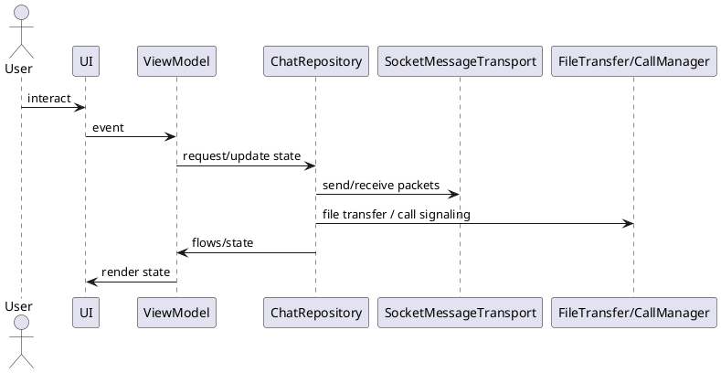

Kiến trúc (MVVM + Flow)

Mô tả:
- UI: Compose screens (DiscoveryScreen, ChatScreen) with NavHost.
- ViewModel: DiscoveryViewModel, ChatViewModel expose StateFlow / SharedFlow.
- Data layer: ChatRepositoryImpl orchestrates MessageTransport, DB, FileTransfer, CallManager.
- Transport: SocketMessageTransport handles socket IO and handshake.
- Persistence: Room (MessageEntity, PeerDao)
- DI: Hilt provides AppScope, repositories, transports.

Sơ đồ luồng tổng quan:
UI <-> ViewModel <-> ChatRepository <-> SocketMessageTransport / FileTransfer / CallManager

Ghi chú:
- Use collectAsStateWithLifecycle() in UI to safely collect flows.

Bảng đặc tả use case:
| Thuộc Tính | Mô tả |
| --- | --- |
| Mã UC | UC-ARC-01 |
| Tên | Điều phối kiến trúc ứng dụng |
| Actor | Người dùng ứng dụng, hệ thống |
| Mô tả | Điều phối UI, ViewModel, repository, transport và lớp lưu trữ theo luồng MVVM + Flow. |
| Tiền điều kiện | Ứng dụng đã khởi tạo và DI đã sẵn sàng. |
| Luồng chính | UI phát sự kiện -> ViewModel xử lý state -> repository điều phối transport/persistence -> UI render dữ liệu mới. |
| Luồng thay thế | Khi lỗi transport hoặc lưu trữ xảy ra, state lỗi được phát về UI để xử lý. |
| Hậu điều kiện | Các lớp được tách biệt nhưng đồng bộ qua một luồng dữ liệu thống nhất. |

Use case specification:
- Primary actor: Application user.
- Preconditions: App is launched and dependencies are available.
- Trigger: User navigates between discovery, chat, file transfer, or call features.
- Main flow: UI emits events -> ViewModel updates state -> repository coordinates transport and persistence -> UI renders latest state.
- Postconditions: Feature modules remain decoupled and data flows through a single repository entry point.
- Exceptions: Transport or storage failures surface through ViewModel state and status flows.

PlantUML sequence diagram:
