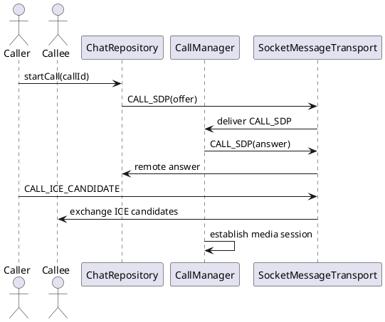

Call Signaling (CallManager)

Mô tả:
- CallManager stub implements signaling packet handling. Intended to integrate WebRTC later.

Packet mẫu:
CALL_SDP:
{
  "type": "CALL_SDP",
  "callId": "call-1",
  "sdp": "v=0..."
}
CALL_ICE_CANDIDATE:
{
  "type": "CALL_ICE_CANDIDATE",
  "callId": "call-1",
  "candidate": "candidate:..."
}

Sơ đồ luồng:
User starts call -> ChatRepository.chatTransport sends CALL_SDP to peer -> peer CallManager handles remote SDP -> establish P2P media (WebRTC)

Ghi chú:
- To implement real calls: add WebRTC dependency, PeerConnection, media streams; use existing packets to exchange SDP and ICE.

Bảng đặc tả use case:
| Thuộc Tính | Mô tả |
| --- | --- |
| Mã UC | UC-CALL-01 |
| Tên | Báo hiệu cuộc gọi |
| Actor | Người gọi, người nhận |
| Mô tả | Trao đổi SDP và ICE để thiết lập phiên gọi P2P. |
| Tiền điều kiện | Hai peer đã kết nối và xác thực thành công. |
| Luồng chính | Người gọi gửi CALL_SDP -> người nhận xử lý SDP -> trao đổi ICE candidates -> thiết lập media session. |
| Luồng thay thế | SDP/ICE không hợp lệ thì kết thúc thiết lập cuộc gọi và báo lỗi. |
| Hậu điều kiện | Phiên gọi được thiết lập hoặc bị hủy an toàn. |

Use case specification:
- Primary actor: Calling user.
- Preconditions: Peers are connected and authenticated.
- Trigger: User starts or receives a call.
- Main flow: ChatRepository sends CALL_SDP -> remote CallManager receives and applies SDP -> ICE candidates are exchanged -> media session is established.
- Postconditions: A peer-to-peer media session is ready or the call fails cleanly.
- Exceptions: Invalid SDP or ICE data ends the call setup and reports failure.

PlantUML sequence diagram:
