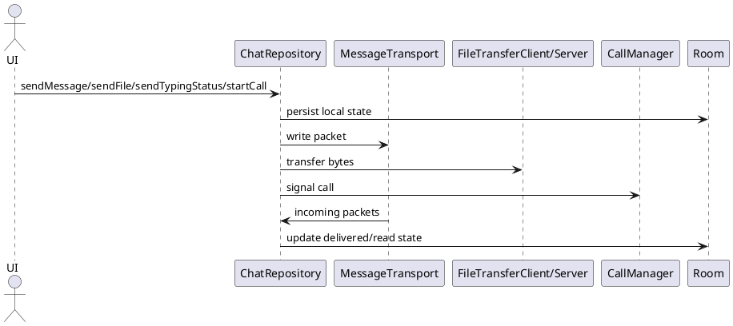

ChatRepository (Chi tiết chức năng)

Mô tả:
- Single entry point for messaging, typing, file transfer, and call signaling.
- Lưu tin nhắn trước khi gửi; quản lý pendingFileTransfers map; expose observeFileProgress, observeTypingStatus.

APIs (public):
- sendMessage(peerAddress, text)
- sendGroupMessage(groupId, text)
- sendFile(peerAddress, uri)
- observeFileProgress(fileTransferId): Flow<Float>
- sendTypingStatus(peerAddress, isTyping)
- observeTypingStatus(peerAddress): Flow<Boolean>
- startCall(targetPeerId, callId), stopCall(callId)

Luồng nội bộ (ví dụ gửi file):
sendFile() -> create fileTransferId -> pendingFileTransfers[fileTransferId]=uri -> send FILE_HEADER over control -> when remote ready, FileTransferClient connects and streams -> update _fileProgressMap

Ghi chú:
- Emits typing statuses via MutableSharedFlow; keep buffer for bursts.

Bảng đặc tả use case:
| Thuộc Tính | Mô tả |
| --- | --- |
| Mã UC | UC-REPO-01 |
| Tên | Điều phối dữ liệu chat |
| Actor | UI, transport, file service, call manager |
| Mô tả | Là đầu mối cho gửi tin nhắn, file, typing status và signaling cuộc gọi. |
| Tiền điều kiện | Repository đã được khởi tạo và có các dependency cần thiết. |
| Luồng chính | UI gọi API -> repository lưu cục bộ -> điều phối transport/dịch vụ -> phát flow trạng thái ra UI. |
| Luồng thay thế | Khi thất bại, repository giữ dữ liệu cục bộ và báo lỗi để retry. |
| Hậu điều kiện | Dữ liệu chat, tiến trình file và trạng thái typing được đồng bộ. |

Use case specification:
- Primary actor: UI layer and peer transport.
- Preconditions: Repository is initialized and transport/persistence are available.
- Trigger: The app sends a message, file, typing update, or call event.
- Main flow: Repository persists local state -> delegates to transport or file service -> exposes flows for progress and typing -> receives remote updates back into storage.
- Postconditions: Message, typing, file, and call state stay consistent across layers.
- Exceptions: Failed transport operations are surfaced to the caller and can be retried.

PlantUML sequence diagram:
