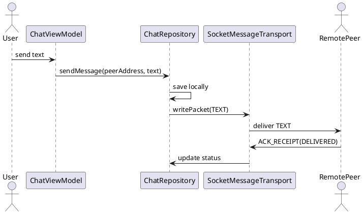

Chat 1:1 (Gửi/nhận tin nhắn)

Mô tả:
- Gửi và nhận tin nhắn văn bản, lưu vào Room trước khi gửi.

Endpoints / Ports:
- Control channel (socket): port 8988 (app protocol over TCP socket)

Packet mẫu (TEXT):
{
  "type": "TEXT",
  "messageId": "uuid-1234",
  "senderId": "peerHashA",
  "text": "Xin chào",
  "timestamp": 1670000000000
}

ACK khi nhận: (ACK_RECEIPT)
{
  "type": "ACK_RECEIPT",
  "messageId": "uuid-1234",
  "status": "DELIVERED"
}

Sơ đồ luồng:
UI -> ChatViewModel -> ChatRepository.sendMessage() -> SocketMessageTransport.writePacket(TEXT)
Remote receives TEXT -> saves locally -> sends ACK_RECEIPT -> original updates status to DELIVERED

Ghi chú:
- Messages saved locally before gửi để hỗ trợ offline và trạng thái hiển thị.

Bảng đặc tả use case:
| Thuộc Tính | Mô tả |
| --- | --- |
| Mã UC | UC-CHAT-01 |
| Tên | Chat 1:1 |
| Actor | Người dùng, peer từ xa |
| Mô tả | Gửi và nhận tin nhắn văn bản giữa hai peer qua control channel. |
| Tiền điều kiện | Hai peer đã kết nối và có thể trao đổi packet TEXT. |
| Luồng chính | Người dùng gửi tin nhắn -> lưu cục bộ -> gửi TEXT -> peer nhận lưu lại -> trả ACK_RECEIPT -> cập nhật trạng thái. |
| Luồng thay thế | Nếu lỗi truyền, tin nhắn vẫn được giữ cục bộ để retry. |
| Hậu điều kiện | Tin nhắn tồn tại ở cả hai phía và trạng thái được cập nhật. |

Use case specification:
- Primary actor: Signed-in peer.
- Preconditions: A verified connection to a remote peer exists.
- Trigger: User sends a text message.
- Main flow: UI calls sendMessage() -> repository stores message locally -> transport sends TEXT -> receiver stores it and returns ACK_RECEIPT -> sender updates delivery status.
- Postconditions: Both peers have a persisted message record with synchronized status.
- Exceptions: If transport fails, the local message remains stored for retry.

PlantUML sequence diagram:
