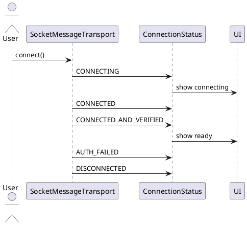

Connection Status (Trạng thái kết nối)

Mô tả:
- Các trạng thái kết nối được mô tả trong ConnectionStatus enum.

Các trạng thái:
- DISCONNECTED
- CONNECTING
- CONNECTED
- CONNECTED_AND_VERIFIED
- AUTH_FAILED

Usage:
- SocketMessageTransport emits ConnectionStatus updates for UI and repository.

Sơ đồ luồng:
Socket connect attempt -> emit CONNECTING -> handshake -> on success emit CONNECTED_AND_VERIFIED -> on failure emit AUTH_FAILED -> on socket close emit DISCONNECTED

Ghi chú:
- CONNECTED_AND_VERIFIED chỉ emit sau handshake/crypto verification hoàn thành.

Bảng đặc tả use case:
| Thuộc Tính | Mô tả |
| --- | --- |
| Mã UC | UC-CONN-01 |
| Tên | Quản lý trạng thái kết nối |
| Actor | Socket transport, UI |
| Mô tả | Phát và tiêu thụ trạng thái kết nối trong suốt vòng đời socket. |
| Tiền điều kiện | Đang thực hiện kết nối hoặc socket đang hoạt động. |
| Luồng chính | Emit CONNECTING -> handshake -> CONNECTED_AND_VERIFIED -> khi đóng socket emit DISCONNECTED. |
| Luồng thay thế | Xác thực thất bại thì emit AUTH_FAILED. |
| Hậu điều kiện | UI và repository nhận được trạng thái đúng của kết nối. |

Use case specification:
- Primary actor: Socket transport and UI.
- Preconditions: A connection attempt is in progress or the socket is active.
- Trigger: Connection lifecycle changes.
- Main flow: Emit CONNECTING -> progress through handshake -> emit CONNECTED or CONNECTED_AND_VERIFIED -> on error emit AUTH_FAILED -> on close emit DISCONNECTED.
- Postconditions: Consumers can react to the current connection state.
- Exceptions: Authentication failures and socket closures map to dedicated terminal states.

PlantUML sequence diagram:
