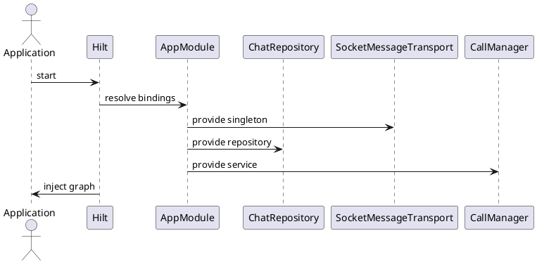

Dependency Injection (Hilt)

Mô tả:
- Hilt modules register AppScope singletons: ChatRepositoryImpl, SocketMessageTransport, KeyStoreManager, CallManager.

Key bindings (ví dụ):
- @Provides fun provideSocketTransport(...): MessageTransport = SocketMessageTransport(...)
- @Singleton fun provideChatRepository(...): ChatRepository = ChatRepositoryImpl(...)

Ghi chú:
- ApplicationScope coroutine scope is provided and injected into transports to manage long-lived coroutines.
- When modifying DI, update di/AppModule.kt.

Bảng đặc tả use case:
| Thuộc Tính | Mô tả |
| --- | --- |
| Mã UC | UC-DI-01 |
| Tên | Tiêm phụ thuộc ứng dụng |
| Actor | Hệ thống khởi động ứng dụng |
| Mô tả | Cấu hình và cung cấp các singleton/scoped object qua Hilt. |
| Tiền điều kiện | Hilt và AppModule được khai báo đúng. |
| Luồng chính | Hilt resolve bindings -> cung cấp repository/transport/service -> inject vào các lớp sử dụng. |
| Luồng thay thế | Thiếu binding thì graph khởi tạo thất bại ngay khi app start. |
| Hậu điều kiện | Các dependency dùng chung được sẵn sàng cho toàn bộ ứng dụng. |

Use case specification:
- Primary actor: Application startup.
- Preconditions: Hilt is configured for the app module.
- Trigger: The process starts and dependency graph is created.
- Main flow: Hilt provides singletons and scoped objects -> transports and repositories receive their dependencies -> app features resolve the same shared instances.
- Postconditions: Core services are wired and ready for use.
- Exceptions: Missing bindings fail fast during graph creation.

PlantUML sequence diagram:

