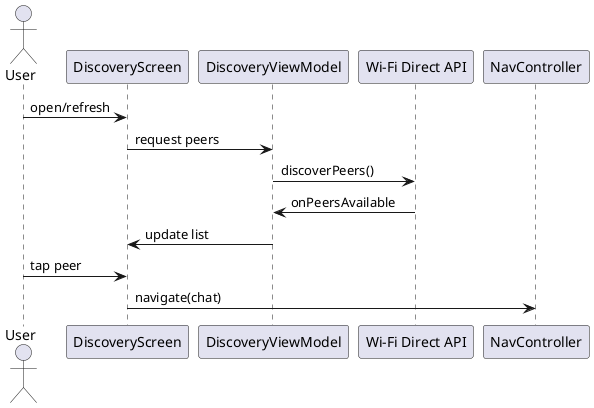

Discovery (Khám phá peer)

Mô tả:
- Khám phá peer qua Wi‑Fi Direct (discoverPeers) và hiển thị danh sách trong DiscoveryScreen.

Endpoints / APIs:
- Local: Wi‑Fi Direct APIs (Android) — không có HTTP
- Giao tiếp nội bộ: DiscoveryViewModel exposes events -> UI

Packet / Payload mẫu:
- Không có packet mạng chuyên biệt. Thông tin peer được lấy từ WifiP2pDevice:
{
  "deviceName": "Peer-Device",
  "deviceAddress": "02:11:22:33:44:55",
  "isGroupOwner": false
}

Sơ đồ luồng (ASCII):
DiscoveryManager -> system WiFiP2p -> onPeersAvailable -> DiscoveryViewModel -> UI (DiscoveryScreen)

Ghi chú:
- Khi chọn peer, mã dùng Uri.encode(peerAddress) khi điều hướng sang Chat để tránh ký tự đặc biệt.

Bảng đặc tả use case:
| Thuộc Tính | Mô tả |
| --- | --- |
| Mã UC | UC-DISC-01 |
| Tên | Khám phá peer |
| Actor | Người dùng, hệ thống Wi‑Fi Direct |
| Mô tả | Tìm và hiển thị các peer khả dụng để người dùng chọn kết nối. |
| Tiền điều kiện | Wi‑Fi Direct được bật và quyền cần thiết đã được cấp. |
| Luồng chính | Người dùng mở màn hình -> hệ thống quét peer -> ViewModel cập nhật danh sách -> UI hiển thị peer -> người dùng chọn peer. |
| Luồng thay thế | Nếu không tìm thấy peer, danh sách rỗng và UI hiển thị trạng thái phù hợp. |
| Hậu điều kiện | Peer được chọn và có thể dùng cho điều hướng sang chat. |

Use case specification:
- Primary actor: User searching for nearby peers.
- Preconditions: Wi-Fi Direct is enabled and discovery permission is granted.
- Trigger: User opens the discovery screen or refreshes peers.
- Main flow: System discovers peers -> DiscoveryViewModel exposes the list -> UI renders available devices -> user selects one to start chat.
- Postconditions: A peer is chosen and its address can be passed to navigation.
- Exceptions: If discovery is unavailable, the list remains empty and the UI should reflect that state.

PlantUML sequence diagram:
