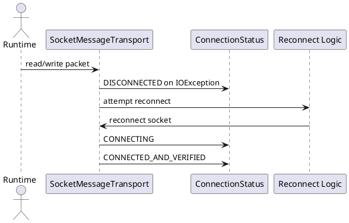

Error Handling & Reconnect

Mô tả:
- Socket IO wrapped in try/catch. On IOException emit DISCONNECTED and attempt reconnect if ForegroundService alive.
- Guard against ACK loops and duplicate processing.

Behaviors:
- Wrap socket.read() with try/catch(IOException) -> on exception emit DISCONNECTED -> reconnect logic tries to re-establish socket.
- ACK loop guard: when receiving ACK_RECEIPT, ensure packet.senderId != localPeerId and status not already applied.

Sơ đồ luồng:
Socket.read() throws IOException -> emit DISCONNECTED -> if service alive attempt reconnect -> on success emit CONNECTING -> handshake -> CONNECTED_AND_VERIFIED

Ghi chú:
- Unit tests should cover ACK loop guard and reconnect sequences.

Bảng đặc tả use case:
| Thuộc Tính | Mô tả |
| --- | --- |
| Mã UC | UC-ERR-01 |
| Tên | Xử lý lỗi và tự kết nối lại |
| Actor | Runtime socket, service nền |
| Mô tả | Bắt lỗi IO, phát trạng thái phù hợp và thử khôi phục kết nối. |
| Tiền điều kiện | Socket đang hoạt động hoặc đang được khởi tạo lại. |
| Luồng chính | Phát hiện IOException -> emit DISCONNECTED -> thử reconnect -> handshake lại -> trở về CONNECTED_AND_VERIFIED. |
| Luồng thay thế | Nếu không thể reconnect, trạng thái lỗi được giữ để UI xử lý. |
| Hậu điều kiện | Kết nối được khôi phục hoặc lỗi được báo rõ ràng. |

Use case specification:
- Primary actor: Socket transport runtime.
- Preconditions: A live socket connection exists or is being retried.
- Trigger: A read/write failure or invalid packet is detected.
- Main flow: Catch IOException -> emit DISCONNECTED -> optionally reconnect -> restart handshake -> return to CONNECTED_AND_VERIFIED.
- Postconditions: The transport either recovers or surfaces a terminal failure.
- Exceptions: Duplicate ACKs are ignored instead of reprocessed.

PlantUML sequence diagram:
