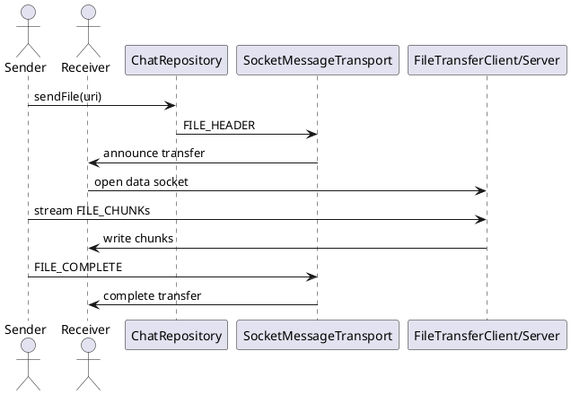

File Transfer

Mô tả:
- Tách kênh điều khiển và kênh truyền file. Control channel on 8988, file bytes on 8989.
- File transfer uses FILE_HEADER -> FILE_CHUNK(s) -> FILE_COMPLETE protocol.

Endpoints / Ports:
- Control: 8988 (announce)
- Data transfer: 8989 (FileTransferServer/Client)

Packet mẫu (control):
FILE_HEADER:
{
  "type": "FILE_HEADER",
  "fileTransferId": "uuid-ft-1",
  "fileName": "photo.jpg",
  "mimeType": "image/jpeg",
  "totalSize": 1234567,
  "totalChunks": 12
}
FILE_CHUNK (on data socket):
{
  "fileTransferId": "uuid-ft-1",
  "chunkIndex": 0,
  "data": "BASE64_CHUNK"
}
FILE_COMPLETE:
{
  "type": "FILE_COMPLETE",
  "fileTransferId": "uuid-ft-1"
}

Sơ đồ luồng:
Sender -> send FILE_HEADER over 8988 -> Receiver opens FileTransferServer (8989) -> Receiver signals READY -> Sender connects to 8989 -> stream chunks -> Receiver writes file -> send FILE_COMPLETE

Progress:
- ChatRepository exposes observeFileProgress(fileTransferId): Flow<Float>

Ghi chú:
- Use separate socket to avoid blocking control channel; update progress via shared flow.

Bảng đặc tả use case:
| Thuộc Tính | Mô tả |
| --- | --- |
| Mã UC | UC-FILE-01 |
| Tên | Truyền file |
| Actor | Người gửi, người nhận |
| Mô tả | Gửi file qua kênh dữ liệu riêng để không làm nghẽn control channel. |
| Tiền điều kiện | Peer đã kết nối và URI file truy cập được. |
| Luồng chính | Gửi FILE_HEADER -> mở kênh dữ liệu -> stream FILE_CHUNK -> ghi file -> gửi FILE_COMPLETE. |
| Luồng thay thế | Lỗi socket dữ liệu thì chuyển trạng thái dang dở và cho phép gửi lại. |
| Hậu điều kiện | File được lưu thành công ở phía nhận hoặc chuyển trạng thái thất bại. |

Use case specification:
- Primary actor: User sending a file.
- Preconditions: A verified peer connection exists and the file URI is accessible.
- Trigger: User chooses a file to share.
- Main flow: sendFile() emits FILE_HEADER over the control channel -> receiver prepares the data socket -> sender streams chunks on 8989 -> receiver writes the file -> FILE_COMPLETE closes the transfer.
- Postconditions: The file is saved on the receiving side and progress reaches 100%.
- Exceptions: If the data socket fails, the transfer remains incomplete and can be retried.

PlantUML sequence diagram:
