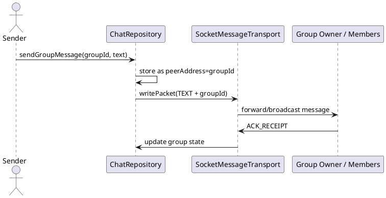

Group Chat

Mô tả:
- Gửi tin nhắn nhóm bằng cách dùng groupId làm peerAddress lưu trữ.

Endpoints / Ports:
- Control channel (port 8988). Group messages routed to groupId.

Packet mẫu (TEXT cho group):
{
  "type": "TEXT",
  "messageId": "uuid-gg-1",
  "senderId": "peerHashA",
  "groupId": "group-123",
  "text": "Hello group",
  "timestamp": 1670000000000
}

Sơ đồ luồng:
Sender -> sendMessage(groupId) -> broadcast/forward via group owner -> each member receives TEXT -> each member sends ACK_RECEIPT back to sender (or group owner)

Ghi chú:
- Implementation stores group messages with peerAddress = groupId để UI subscribe kênh.

Bảng đặc tả use case:
| Thuộc Tính | Mô tả |
| --- | --- |
| Mã UC | UC-GROUP-01 |
| Tên | Chat nhóm |
| Actor | Thành viên nhóm |
| Mô tả | Gửi và nhận tin nhắn trong nhóm bằng groupId làm định danh kênh. |
| Tiền điều kiện | Nhóm đã tồn tại và các thành viên có thể truy cập kênh nhóm. |
| Luồng chính | Thành viên gửi message cho groupId -> repository lưu cục bộ -> transport forward packet -> các thành viên nhận và ACK. |
| Luồng thay thế | Thành viên offline vẫn giữ bản ghi cục bộ để đồng bộ lại sau. |
| Hậu điều kiện | Tin nhắn nhóm hiển thị trong mọi thành viên hợp lệ của nhóm. |

Use case specification:
- Primary actor: Group member.
- Preconditions: The group identifier is known and the network route to members exists.
- Trigger: User sends a message to a group.
- Main flow: sendGroupMessage(groupId, text) -> repository stores with peerAddress = groupId -> transport forwards the TEXT packet -> members receive and acknowledge it.
- Postconditions: The message appears in every group member's conversation view.
- Exceptions: If a member is offline, the local record still remains for later sync.

PlantUML sequence diagram:
