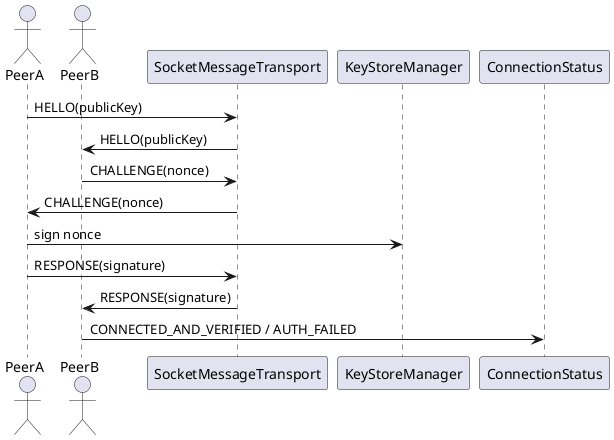

Handshake & Authentication (Pubkey exchange + challenge-response)

Mô tả:
- 3-phase handshake: exchange public keys, challenge/response, verify peer identity via KeyStoreManager.

Ports / Channel:
- Control channel over socket (8988)

Simplified handshake packets:
1) HELLO (contains publicKey)
{
  "type": "HELLO",
  "publicKey": "BASE64_PUBKEY",
  "peerId": "peerHashCandidate"
}
2) CHALLENGE
{
  "type": "CHALLENGE",
  "nonce": "random-hex"
}
3) RESPONSE
{
  "type": "RESPONSE",
  "nonce": "signed-by-private-key (BASE64)"
}
4) VERIFY_OK / VERIFY_FAIL
{
  "type": "VERIFY_OK"
}

Sơ đồ luồng:
A sends HELLO -> B validates -> B sends CHALLENGE -> A signs nonce -> A sends RESPONSE -> B verifies signature -> emit CONNECTED_AND_VERIFIED or AUTH_FAILED

Ghi chú:
- KeyStoreManager cung cấp peerId hash và quản lý keys.

Bảng đặc tả use case:
| Thuộc Tính | Mô tả |
| --- | --- |
| Mã UC | UC-HAND-01 |
| Tên | Bắt tay và xác thực |
| Actor | Hai peer |
| Mô tả | Trao đổi public key, challenge và response để xác thực lẫn nhau. |
| Tiền điều kiện | Socket đã kết nối và hai bên có thể trao đổi dữ liệu. |
| Luồng chính | Gửi HELLO -> phát CHALLENGE -> ký nonce -> gửi RESPONSE -> xác minh -> emit CONNECTED_AND_VERIFIED. |
| Luồng thay thế | Sai chữ ký hoặc thiếu khóa thì chuyển sang AUTH_FAILED. |
| Hậu điều kiện | Phiên kết nối được xác thực hoặc bị từ chối an toàn. |

Use case specification:
- Primary actor: Two peers establishing trust.
- Preconditions: A socket connection exists and both sides can exchange keys.
- Trigger: The handshake starts after connection setup.
- Main flow: Exchange HELLO -> issue CHALLENGE -> send signed RESPONSE -> verify signature -> emit CONNECTED_AND_VERIFIED.
- Postconditions: Both peers trust the session and can start secure messaging.
- Exceptions: Invalid signatures or missing keys cause AUTH_FAILED.

PlantUML sequence diagram:
