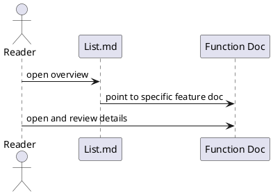

Danh sách tính năng của P2P_Chat

Các file chi tiết (trong cùng thư mục):
- Discovery.md — Khám phá peer (Wi‑Fi Direct)
- Navigation.md — Điều hướng Discovery → Chat
- Chat_1to1.md — Gửi/nhận tin nhắn 1:1, ACK
- Group_Chat.md — Tin nhắn nhóm (groupId)
- Connection_Status.md — Các trạng thái kết nối
- Handshake_and_Auth.md — Pubkey exchange & challenge/response
- ACK_Receipt.md — Biên nhận DELIVERED / READ
- Typing_Indicator.md — TYPING_STATUS với debounce
- File_Transfer.md — FILE_HEADER/CHUNK/COMPLETE (port 8989)
- Call_Signaling.md — CALL_SDP / CALL_ICE_CANDIDATE (signaling)
- Architecture.md — Kiến trúc MVVM + Flow + DI
- ChatRepository.md — APIs: sendMessage, sendFile, typing, observe flows
- Error_Handling_and_Reconnect.md — IOException handling & reconnect
- Dependency_Injection.md — Hilt bindings và AppScope

Mỗi file chứa: mô tả, endpoints/ports, mẫu payload JSON, và sơ đồ luồng (ASCII).

Bảng đặc tả use case:
| Thuộc Tính | Mô tả |
| --- | --- |
| Mã UC | UC-LIST-01 |
| Tên | Tổng quan các chức năng |
| Actor | Người đọc tài liệu |
| Mô tả | Liệt kê các file chức năng để người đọc truy cập nhanh vào đặc tả chi tiết. |
| Tiền điều kiện | Thư mục Function đã tồn tại các file đặc tả. |
| Luồng chính | Mở danh sách -> chọn file phù hợp -> đọc đặc tả chi tiết. |
| Luồng thay thế | Nếu chưa có file cần tìm, coi đó là khoảng trống cần bổ sung. |
| Hậu điều kiện | Người đọc xác định đúng tài liệu cần xem tiếp theo. |

Use case specification:
- Primary actor: Reader or maintainer of the documentation.
- Preconditions: The repository is open and the function docs are available.
- Trigger: User opens the Function folder overview.
- Main flow: Read the overview -> choose the relevant feature doc -> open the detailed file for the desired behavior.
- Postconditions: The reader can locate the correct feature specification quickly.
- Exceptions: Missing docs are treated as gaps to be filled later.

PlantUML sequence diagram:

