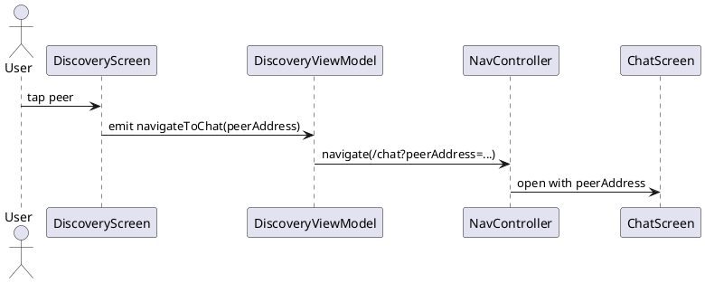

Navigation (Điều hướng)

Mô tả:
- Sử dụng Navigation Compose để điều hướng DiscoveryScreen -> ChatScreen.

APIs / Routes:
- Route: /chat?peerAddress={peerAddress}
- Khi gọi: NavController.navigate("/chat?peerAddress=${Uri.encode(peerAddress)}")

Payload mẫu khi chuyển tiếp:
{
  "peerAddress": "192.168.49.1",
  "displayName": "Alice"
}

Sơ đồ luồng:
User tap peer -> DiscoveryViewModel.emit(navigateToChat(peerAddress)) -> NavHost -> ChatScreen receives peerAddress

Ghi chú:
- Luôn encode argument để tránh lỗi với ký tự đặc biệt.

Bảng đặc tả use case:
| Thuộc Tính | Mô tả |
| --- | --- |
| Mã UC | UC-NAV-01 |
| Tên | Điều hướng sang chat |
| Actor | Người dùng |
| Mô tả | Chuyển từ danh sách peer sang màn hình chat với peer đã chọn. |
| Tiền điều kiện | Đã có peerAddress hợp lệ từ DiscoveryScreen. |
| Luồng chính | Người dùng chọn peer -> ViewModel phát navigation event -> NavController mở ChatScreen. |
| Luồng thay thế | Nếu peerAddress không hợp lệ, điều hướng bị chặn bằng việc encode/validate. |
| Hậu điều kiện | Màn hình chat mở với đúng peer được chọn. |

Use case specification:
- Primary actor: User selecting a peer.
- Preconditions: A peer address is available from discovery.
- Trigger: User taps a peer in DiscoveryScreen.
- Main flow: DiscoveryViewModel emits a navigation event -> NavController navigates to ChatScreen -> ChatScreen receives the encoded peerAddress.
- Postconditions: The chat view opens for the selected peer.
- Exceptions: Invalid route arguments are prevented by encoding the peer address first.

PlantUML sequence diagram:
