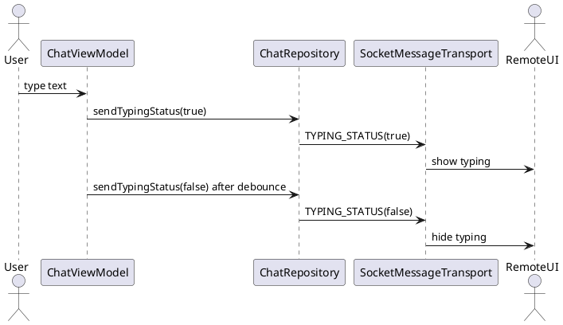

Typing Indicator (TYPING_STATUS)

Mô tả:
- Gửi trạng thái đang gõ (isTyping) với debounce (3s stop-typing).

Packet mẫu:
{
  "type": "TYPING_STATUS",
  "isTyping": true
}

APIs:
- ChatRepository.sendTypingStatus(peerAddress, isTyping)
- ChatRepository.observeTypingStatus(peerAddress): Flow<Boolean>

Sơ đồ luồng:
User types -> ChatViewModel debounces -> sendTypingStatus(true) -> remote UI shows typing -> after 3s inactivity sendTypingStatus(false)

Ghi chú:
- Use debounce to avoid flooding the control channel.

Bảng đặc tả use case:
| Thuộc Tính | Mô tả |
| --- | --- |
| Mã UC | UC-TYPE-01 |
| Tên | Hiển thị trạng thái đang gõ |
| Actor | Người dùng chat, peer từ xa |
| Mô tả | Báo trạng thái đang nhập để UI phía nhận hiển thị typing indicator. |
| Tiền điều kiện | Cuộc chat đang mở và có kết nối với peer. |
| Luồng chính | Người dùng nhập -> ViewModel debounce -> gửi true -> phía nhận hiển thị -> hết nhập gửi false. |
| Luồng thay thế | Thay đổi quá nhanh được gộp lại để tránh flood kênh điều khiển. |
| Hậu điều kiện | Trạng thái typing phản ánh đúng hoạt động của người dùng. |

Use case specification:
- Primary actor: Chat participant.
- Preconditions: A chat session is open with a remote peer.
- Trigger: The user starts or stops typing.
- Main flow: ChatViewModel debounces input -> sendTypingStatus(true) -> remote UI displays typing state -> after inactivity sendTypingStatus(false).
- Postconditions: The remote peer sees an accurate typing indicator.
- Exceptions: Rapid typing changes are coalesced by debounce.

PlantUML sequence diagram:
