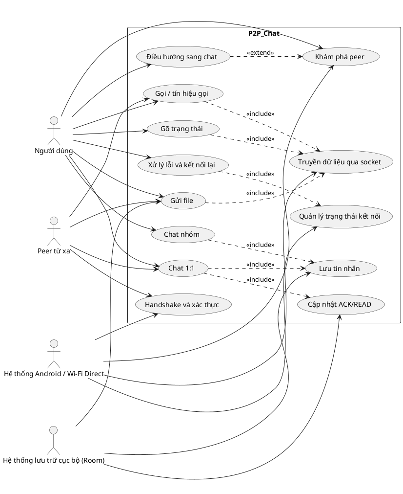

# System Analysis

## 1. Mục tiêu hệ thống

Hệ thống P2P_Chat cho phép hai thiết bị Android khám phá nhau qua Wi‑Fi Direct, thiết lập kết nối an toàn, trao đổi tin nhắn 1:1, tin nhắn nhóm, trạng thái gõ, biên nhận đọc/gửi, truyền file và tín hiệu gọi.

## 2. Danh sách actor

| Actor | Vai trò |
| --- | --- |
| Người dùng | Khởi tạo và sử dụng các chức năng chat, file, gọi và điều hướng. |
| Peer từ xa | Thiết bị đối tác nhận/gửi dữ liệu P2P. |
| Hệ thống Android / Wi‑Fi Direct | Cung cấp khám phá peer, kết nối và socket giao tiếp. |
| Hệ thống lưu trữ cục bộ (Room) | Lưu tin nhắn, trạng thái và dữ liệu tiến trình. |

## 3. Đặc tả yêu cầu theo actor

### 3.1 Người dùng

**Yêu cầu chức năng**
- Khám phá và chọn peer để kết nối.
- Gửi và nhận tin nhắn 1:1.
- Gửi và nhận tin nhắn nhóm.
- Gửi file qua kênh dữ liệu riêng.
- Theo dõi trạng thái kết nối, trạng thái gửi/nhận và chỉ báo đang nhập.
- Nhận thông tin tín hiệu gọi khi ứng dụng hỗ trợ.

**Yêu cầu phi chức năng**
- Giao diện phải rõ ràng, dễ thao tác, phản hồi nhanh.
- Thao tác gửi/nhận phải hiển thị trạng thái kịp thời.
- Dữ liệu chat cần được bảo toàn khi mất kết nối tạm thời.
- Trải nghiệm phải nhất quán giữa các màn hình Discovery và Chat.

**Yêu cầu hệ thống**
- Thiết bị phải chạy Android và cấp quyền cần thiết cho Wi‑Fi Direct, mạng và lưu trữ.
- Ứng dụng phải có khả năng truy cập socket TCP nội bộ và socket file transfer.
- Ứng dụng phải lưu dữ liệu vào Room để khôi phục lịch sử và trạng thái.

### 3.2 Peer từ xa

**Yêu cầu chức năng**
- Tham gia quá trình handshake và xác thực.
- Nhận/gửi packet TEXT, ACK_RECEIPT, TYPING_STATUS, FILE_HEADER, FILE_COMPLETE và gói tín hiệu gọi.
- Phản hồi ACK để cập nhật trạng thái gửi/nhận.

**Yêu cầu phi chức năng**
- Phản hồi phải nhanh và ổn định.
- Dữ liệu trao đổi phải tương thích định dạng packet giữa hai thiết bị.
- Mất kết nối tạm thời không được làm hỏng dữ liệu đã lưu cục bộ.

**Yêu cầu hệ thống**
- Cả hai thiết bị phải cùng hỗ trợ giao thức packet của ứng dụng.
- Peer phải ở trong phạm vi Wi‑Fi Direct khả dụng hoặc đã có kênh kết nối hợp lệ.

### 3.3 Hệ thống Android / Wi‑Fi Direct

**Yêu cầu chức năng**
- Quét và phát hiện peer khả dụng.
- Thiết lập nhóm Wi‑Fi Direct và tạo kết nối socket.
- Cung cấp trạng thái kết nối: DISCONNECTED, CONNECTING, CONNECTED, CONNECTED_AND_VERIFIED, AUTH_FAILED.
- Hỗ trợ chuyển tiếp dữ liệu điều khiển qua port 8988 và file qua port 8989.

**Yêu cầu phi chức năng**
- Hoạt động ổn định trên môi trường mạng không chắc chắn.
- Xử lý lỗi mạng và tự phục hồi khi có thể.
- Không làm treo UI khi quét peer hoặc truyền file.

**Yêu cầu hệ thống**
- Thiết bị phải hỗ trợ Wi‑Fi Direct.
- Ứng dụng phải được cấp quyền runtime cần thiết để khám phá và kết nối peer.
- Hệ thống phải cho phép sử dụng socket TCP nội bộ cho giao tiếp P2P.

### 3.4 Hệ thống lưu trữ cục bộ (Room)

**Yêu cầu chức năng**
- Lưu tin nhắn trước khi gửi.
- Cập nhật trạng thái DELIVERED và READ theo ACK_RECEIPT.
- Lưu trạng thái tiến trình file transfer và dữ liệu chat để hiển thị lại.

**Yêu cầu phi chức năng**
- Truy vấn phải nhanh để UI hiển thị tức thời.
- Dữ liệu phải nhất quán sau khi ứng dụng khởi động lại.
- Không được làm mất bản ghi khi mạng bị ngắt.

**Yêu cầu hệ thống**
- Ứng dụng phải có schema Room tương thích với các entity chat, trạng thái và file transfer.
- Bộ nhớ thiết bị phải đủ để lưu lịch sử chat theo nhu cầu sử dụng.

## 4. Bảng tổng hợp yêu cầu

| Actor | Yêu cầu chức năng | Yêu cầu phi chức năng | Yêu cầu hệ thống |
| --- | --- | --- | --- |
| Người dùng | Khám phá peer, chat 1:1, chat nhóm, gửi file, theo dõi trạng thái và gọi. | Nhanh, dễ dùng, phản hồi tức thời, nhất quán. | Android, quyền runtime, socket P2P, Room. |
| Peer từ xa | Handshake, nhận/gửi packet, phản hồi ACK, hỗ trợ file và tín hiệu gọi. | Ổn định, tương thích, độ trễ thấp. | Hỗ trợ cùng giao thức và nằm trong phạm vi kết nối. |
| Android / Wi‑Fi Direct | Quét peer, kết nối, quản lý trạng thái, chuyển tiếp dữ liệu qua 8988/8989. | Không treo UI, tự phục hồi lỗi mạng, ổn định. | Hỗ trợ Wi‑Fi Direct và quyền cần thiết. |
| Room | Lưu và cập nhật dữ liệu chat, trạng thái, tiến trình file. | Truy vấn nhanh, nhất quán, không mất dữ liệu. | Có schema lưu trữ phù hợp và đủ dung lượng thiết bị. |

## 5. Danh sách các ca sử dụng theo actor

| Actor | Use case | Mã UC | Mô tả ngắn |
| --- | --- | --- | --- |
| Người dùng | Khám phá peer | UC-DISC-01 | Tìm và chọn peer khả dụng qua Wi‑Fi Direct. |
| Người dùng | Điều hướng sang chat | UC-NAV-01 | Chuyển từ Discovery sang màn hình Chat. |
| Người dùng | Chat 1:1 | UC-CHAT-01 | Gửi và nhận tin nhắn văn bản giữa hai peer. |
| Người dùng | Chat nhóm | UC-GROUP-01 | Gửi tin nhắn vào phòng chat nhóm theo groupId. |
| Người dùng | Gõ trạng thái | UC-TYPING-01 | Gửi/nhận chỉ báo đang nhập. |
| Người dùng | Gửi file | UC-FILE-01 | Truyền file qua kênh dữ liệu riêng. |
| Người dùng | Gọi / tín hiệu gọi | UC-CALL-01 | Trao đổi tín hiệu SDP và ICE cho cuộc gọi. |
| Người dùng | Xử lý lỗi và kết nối lại | UC-RECON-01 | Phục hồi khi mất kết nối hoặc socket lỗi. |
| Peer từ xa | Handshake và xác thực | UC-AUTH-01 | Trao đổi pubkey và challenge/response. |
| Peer từ xa | Nhận/gửi tin nhắn | UC-CHAT-01 | Nhận TEXT và phản hồi ACK_RECEIPT. |
| Peer từ xa | Nhận/gửi file | UC-FILE-01 | Nhận FILE_HEADER, FILE_CHUNK và hoàn tất file. |
| Peer từ xa | Nhận/gửi tín hiệu gọi | UC-CALL-01 | Nhận CALL_SDP và CALL_ICE_CANDIDATE. |
| Hệ thống Android / Wi‑Fi Direct | Phát hiện peer | UC-DISC-01 | Quét peer khả dụng và cung cấp danh sách. |
| Hệ thống Android / Wi‑Fi Direct | Thiết lập kết nối | UC-CONN-01 | Tạo nhóm Wi‑Fi Direct và mở socket giao tiếp. |
| Hệ thống Android / Wi‑Fi Direct | Quản lý trạng thái kết nối | UC-STATUS-01 | Cập nhật DISCONNECTED, CONNECTING, CONNECTED, VERIFIED, AUTH_FAILED. |
| Hệ thống Android / Wi‑Fi Direct | Xử lý truyền dữ liệu | UC-TRANSPORT-01 | Chuyển tiếp packet điều khiển và file qua 8988/8989. |
| Hệ thống lưu trữ cục bộ (Room) | Lưu tin nhắn | UC-STORE-01 | Lưu message trước khi gửi và khôi phục sau khi mở lại app. |
| Hệ thống lưu trữ cục bộ (Room) | Cập nhật biên nhận | UC-ACK-01 | Cập nhật DELIVERED và READ theo ACK_RECEIPT. |
| Hệ thống lưu trữ cục bộ (Room) | Lưu tiến trình file | UC-FILE-01 | Lưu tiến trình truyền file để hiển thị trạng thái. |

## 6. PlantUML use case diagram

## 7. Kết luận

Đặc tả trên xác định các actor chính và các yêu cầu cốt lõi của hệ thống P2P_Chat. Tài liệu này có thể dùng làm đầu vào cho phân tích use case, thiết kế kiến trúc và kiểm thử chức năng.